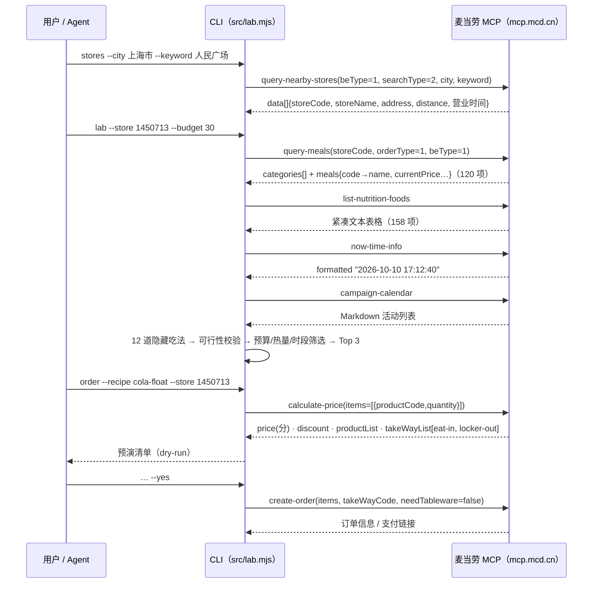

# MCP 集成说明 · MCP_INTEGRATION.md

> 本文说明「麦门隐藏菜单研究所」实际使用的麦当劳 MCP Server、调用的 Tool、完整调用流程、真实返回形态与解析方式、联调证据，以及业务价值。所有内容基于 2026-10-10 的真实联调。

## 1. 使用的 MCP Server

| 项目 | 内容 |
|---|---|
| Server | 麦当劳中国 MCP Server（`serverInfo.name = mcd-mcp`，`version = 1.0.0`，联调实测） |
| 接入地址 | `https://mcp.mcd.cn` |
| 传输协议 | Streamable HTTP（MCP 2025-06-18），响应为 SSE 或 JSON |
| 鉴权 | `Authorization: Bearer <MCD_MCP_TOKEN>`（Token 申请：https://open.mcd.cn/mcp） |
| 配置模板 | [`mcp-config.example.json`](./mcp-config.example.json)（仅环境变量占位符 `${MCD_MCP_TOKEN}`） |
| 客户端实现 | [`src/mcp-client.mjs`](./src/mcp-client.mjs)：零依赖，`initialize → notifications/initialized → tools/list → tools/call`，含 SSE 解析、会话头 `mcp-session-id`、401 / 429 处理与重试 |
| 返回解析 | [`src/mcp-parse.mjs`](./src/mcp-parse.mjs)：针对真实返回形态编写（见第 4 节） |

工具总数（`tools/list` 实测）：**35 个**。

## 2. 实际调用的 Tools

### 2.1 CLI 内置调用（10 个）

| Tool | 用途 | 实测入参 | 调用位置 |
|---|---|---|---|
| `query-nearby-stores` | 查询可点餐门店 | `beType=1, searchType=2, city, keyword`（city 与 keyword 需同时传） | `src/lab.mjs` → `cmdStores` |
| `query-meals` | 实时在售菜单 | `storeCode, orderType=1, beType=1`；加 `reservationDate="yyyy-MM-dd HH:mm"` 可拉取指定时段（用于早餐菜单） | `src/lab.mjs` → `loadContext`；`scripts/refresh-sample-data.mjs` |
| `list-nutrition-foods` | 餐品营养数据（实测 158–160 项） | 无 | `loadContext`；`refresh-sample-data.mjs` |
| `now-time-info` | 服务器时间 → 推断用餐时段（早餐 / 正餐 / 下午茶 / 夜宵） | 无 | `src/lab.mjs` → `resolveClock` |
| `campaign-calendar` | 当月营销活动 → 「活动联动」提示 | 无 | `src/lab.mjs` → `resolveCampaigns` |
| `calculate-price` | 含优惠的实时算价（金额单位：分） | `storeCode, orderType=1, beType=1, items[{productCode, quantity}]` | `src/pricing.mjs` → `quoteViaMcp` |
| `create-order` | 创建到店订单 | 同上 + `takeWayCode`（来自 `calculate-price` 返回的 `takeWayList[].code`，如 `eat-in` / `locker-out`）+ `needTableware` | `src/lab.mjs` → `cmdOrder`（必须显式 `--yes`） |
| `query-meal-detail` | 餐品组成 / 可替换项 / 特调组 | `storeCode, orderType, beType, code` | 联调验证；Agent 模式 B（见 `SKILL.md`） |
| `query-store-coupons` | 当前门店可用优惠券 | `storeCode, orderType, beType` | 联调验证；路线图：自动套券 |
| `tools/list`（协议方法） | 环境自检 | — | `src/lab.mjs` → `cmdDoctor` |

### 2.2 每个命令触发的调用

| 命令 | 触发的 Tool |
|---|---|
| `doctor` | `initialize` · `tools/list` · `now-time-info` |
| `stores` | `query-nearby-stores` |
| `menu` | `query-meals` · `list-nutrition-foods` |
| `lab` | `query-meals` · `list-nutrition-foods` · `now-time-info` · `campaign-calendar` |
| `card` | `query-meals` · `list-nutrition-foods` |
| `price` | `query-meals` · `calculate-price` |
| `order` | `query-meals` · `calculate-price` →（`--yes` 后）`create-order` |
| `scripts/refresh-sample-data.mjs` | `query-meals` ×2（当前 + 次日早餐）· `list-nutrition-foods` |

## 3. 调用流程



核心原则：**数据与计算交给确定性代码，表达交给 Agent**——餐品来自 `query-meals`、价格来自 `calculate-price`、营养来自 `list-nutrition-foods`，语言模型不做心算。

## 4. 真实返回形态与解析（联调要点）

实测发现麦当劳 MCP 的工具返回并非纯 JSON，`src/mcp-parse.mjs` 针对以下形态做了解析：

1. **「说明文字 + JSON」混合文本**：形如 `# API Response Information … ## Original Response {json}`，或展示指引中夹着 `{"success":true,…}`，JSON 前后都可能有文字 → `extractJson()` 用括号配平定位第一个完整 JSON 对象（优先 `{"success"…}`）。
2. **业务体**：`{ success, code, message, datetime, traceId, data }`；`success=false` 时 `message` 为可读错误（如 `城市名或者关键词不能为空`）→ `unwrapBusiness()`。
3. **紧凑文本表格**：`list-nutrition-foods` 的 `data` 是字符串 `[160]{productName,nutritionDescription,energyKj,energyKcal,protein,fat,carbohydrate,sodium,calcium}:\n  中薯条,null,1210,289,4,12,38,165,18\n …` → `parseCompactTable()` / `parseNutritionData()`。
4. **菜单结构**：`data.categories[].meals[].code` + `data.meals[code]{name, currentPrice, originalPrice, discountType}`，分类名含换行 → `normalizeMenuData()` 扁平化、去重、清洗。
5. **活动日历**：Markdown 文本（`#### 2026年10月7日 往期回顾` + `**活动标题**：…`）→ `parseCampaignCalendar()`。
6. **金额单位**：`calculate-price` 返回分（`price: 1850` = ¥18.5），统一换算成元。
7. **名称差异**：菜单叫「薯条 / 麦乐鸡 / 新地 / 派」，营养表叫「中薯条 / 麦乐鸡5块 / 草莓新地 / 菠萝派」→ 配方为每个原料分别维护 `match`（菜单）与 `nutritionMatch`（营养表）两组关键词；菜单匹配优先完全相等、其次取名称最短的包含项，避免命中「xx套餐」。
8. **时段菜单**：下午拉取的菜单没有早餐单品；用 `reservationDate` 指定次日 08:00 可拉到早餐菜单。离线样例由两次快照合并而成（`dayparts` 字段标记）。

## 5. 联调证据（2026-10-10，Token 已脱敏）

| 调用 | 结果摘要 | traceId |
|---|---|---|
| `initialize` | `serverInfo = { name: "mcd-mcp", version: "1.0.0" }` | — |
| `tools/list` | 35 个工具 | — |
| `now-time-info` | `formatted = "2026-10-10 16:50:10"`，`timezone = GMT+08:00` | `d5363fac17ad045b2d76d1799f9c5b39` |
| `list-nutrition-foods` | 160 行营养表（中薯条 289 kcal、巨无霸 513 kcal、圆筒冰淇淋 93 kcal…） | `5449957b356951a3fa6e68c9187bea50` |
| `query-nearby-stores` | 上海市 + 人民广场 → 5 家门店（`1450713` 麦当劳上海黄浦华旭国际大厦餐厅 等） | `8f55d49f1c619d6a75074d1311da14b3` |
| `query-meals` | 门店 `1450713` 到店菜单 120 项、15 个分类 | `8ae31abe2a3cd2b558ce803fbba93d0b` |
| `query-meals` + `reservationDate` | 次日 08:00 早餐菜单 108 项（麦满分 / 脆香油条 / 优品豆浆…） | — |
| `calculate-price` | 中薯条 1350 分 + 灰焰圆筒 500 分 = 1850 分，`takeWayList = [eat-in 堂食, locker-out 外带]` | `fcf31eea9ddb4fd4e14f621bd2573139` |
| `query-meal-detail` | `{ code, name, rounds: [], supportModify: false }` + 特调组传参规则 | `ff028d716130fb40694d3144be7ae820` |
| `query-store-coupons` | `data: []`（当前账户无门店券） | `aaf0a12c02a374c5e60bd6d3656236a3` |
| `campaign-calendar` | 当月活动列表（含「麦当劳 X PEACEMINUSONE」等） | — |

CLI 实时运行记录（`node src/lab.mjs price --recipe fries-float --store 1450713`）：

```text
💰 冰雪薯条 · MCP 实时算价（门店 1450713）

  · 中薯条　¥13.5
  · 圆筒冰淇淋　¥5.0
  合计 ¥18.5
  取餐方式：堂食(eat-in) / 外带(locker-out)
```

`create-order` 已按官方 schema 接入（`items` + `takeWayCode` + `needTableware`），默认仅预演；真实下单需用户显式 `--yes`，开发联调阶段未创建真实订单。

## 6. 业务价值

- **对用户**：把流传在社交平台上的「隐藏吃法」变成**可验证（门店是否能做）、可计算（价格 / 热量）、可执行（一键下单）**的真实方案；时段与活动日历联动让推荐贴近当下；配方卡降低分享门槛。
- **对麦当劳**：提升单品连带（薯条 + 圆筒、派 + 圆筒、鲜萃咖啡 + 圆筒），激活低频单品，产出 UGC 传播素材；所有方案均基于在售餐品，不要求门店做任何特殊处理。
- **对开发者**：零依赖的 MCP 客户端与「说明文字 + JSON」解析器可直接复用；真实快照让没有 Token 的人也能完整体验与贡献。

## 7. 安全与合规

- Token 只存本地 `.env`（已被 `.gitignore` 屏蔽），仓库内一律占位符。
- 只读优先：`query-*`、`calculate-price` 为默认路径；`create-order` 必须 `--yes`，且创建后仍需在官方渠道支付。
- 不臆造餐品：方案中的每一项原料都来自 `query-meals` 实时返回。
- 营养与热量为估算，不构成营养或医疗建议；餐品信息、价格、供应状态以麦当劳官方渠道实时结果为准。
- 本项目为粉丝开源作品，非麦当劳官方产品。
