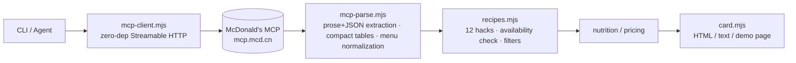

<p align="center">
  
</p>

<h1 align="center">🍟 MCD Secret Menu Lab</h1>
<p align="center">Invent, verify and order McDonald's "secret menu" hacks — built on the official McDonald's China MCP</p>

<p align="center">
  <a href="./README.md">中文</a> · <a href="https://wangwengao.github.io/mcd-secret-menu-lab/demo.html">Live demo</a> · <a href="./MCP_INTEGRATION.md">MCP integration</a>
</p>

> Fries dipped in a soft-serve cone, a cone dropped into a Coke, nuggets stacked inside a double cheeseburger — the internet is full of McDonald's "secret menu" hacks. This project turns them into something you can **verify against a real store menu, price, visualize as a shareable card, and order in one click**. Zero dependencies. Works without a token (real data snapshots included).

## What it does

- **Codex** — 12 curated hacks; every ingredient is a real, currently sold menu item
- **Verify** — pulls the live menu of a store and tells you which hacks are makeable today (and what's missing)
- **Lab** — filter by budget / calories / daypart; daypart is inferred from server time, and the current campaign calendar is surfaced as "campaign tie-ins"
- **Recipe cards** — "classified dossier" style HTML/PNG cards, ready for social media
- **Order** — real-time pricing via `calculate-price` (discounts included), then `create-order` after explicit confirmation

## 30-second tour

Zero-install, pure-static demo: https://wangwengao.github.io/mcd-secret-menu-lab/demo.html — filter by daypart / difficulty, search ingredients, hit "🎲 random", copy the text version or download the PNG.

<table>
  <tr>
    <td align="center"><br>🍟❄️ Snow Fries</td>
    <td align="center"><br>🥤⛷️ Cola Float</td>
    <td align="center"><br>☕🍦 Fresh-brew Affogato</td>
    <td align="center"><br>🍗🍧 Brave Nugget</td>
  </tr>
</table>

Real run (live mode, a Shanghai store, 2026-10-10):

```text
$ node src/lab.mjs price --recipe fries-float --store 1450713

💰 冰雪薯条 · MCP 实时算价（门店 1450713）
  · 中薯条　¥13.5
  · 圆筒冰淇淋　¥5.0
  合计 ¥18.5
  取餐方式：堂食(eat-in) / 外带(locker-out)
```

## Quick start

```bash
git clone https://github.com/wangwengao/mcd-secret-menu-lab.git
cd mcd-secret-menu-lab

# No token needed — real snapshots (183 menu items + 158 nutrition rows) are bundled
node src/lab.mjs recipes
node src/lab.mjs lab --budget 30 --vibe 夜宵
node src/lab.mjs card --recipe fries-float

# Connect the McDonald's MCP (token: https://open.mcd.cn/mcp)
cp .env.example .env            # MCD_MCP_TOKEN=...
node src/lab.mjs doctor
node src/lab.mjs stores --city 上海市 --keyword 人民广场
node src/lab.mjs lab   --store 1450713
node src/lab.mjs order --recipe cola-float --store 1450713        # dry-run
node src/lab.mjs order --recipe cola-float --store 1450713 --yes  # real order
```

Node.js ≥ 18, zero third-party dependencies. `npm test` runs 12 self-tests.

## Use it as an Agent Skill

Configure the McDonald's MCP connector (see [`mcp-config/`](./mcp-config/)), then install the skill into WorkBuddy / Claude Code with `.\install.ps1` or `bash install.sh`, or load [`SKILL.md`](./SKILL.md) in Cherry Studio / Cursor. The skill supports two modes: calling this CLI (recommended — pricing and nutrition are computed deterministically) or orchestrating the MCP tools directly.

## How it works



MCP tools used: `query-nearby-stores`, `query-meals` (incl. `reservationDate` for the breakfast menu), `list-nutrition-foods`, `now-time-info`, `campaign-calendar`, `calculate-price`, `create-order`; verified in integration: `query-meal-detail`, `query-store-coupons`. Details, real response shapes and traceIds: [`MCP_INTEGRATION.md`](./MCP_INTEGRATION.md).

Principle: **data and arithmetic belong to deterministic code; language belongs to the agent.** Items come from `query-meals`, prices from `calculate-price`, calories from `list-nutrition-foods` — the LLM never guesses.

## Honest notes

- Bundled snapshots are real MCP data (pulled by `scripts/refresh-sample-data.mjs`), not hand-written.
- Prices shown offline are snapshot prices; online, `price` / `order` call `calculate-price`.
- Calories are estimates from the official nutrition table; combo products may lack data.
- v1 covers in-store pickup only; delivery is on the roadmap.
- Fan-made open-source project, **not an official McDonald's product**. Menu, prices and availability are subject to McDonald's official channels.

## Contribute a hack

No code needed: open an issue with the "🍟 投稿一个隐藏吃法" template. See [CONTRIBUTING.md](./CONTRIBUTING.md).

## License

[MIT](./LICENSE) © 2026 wangwengao
