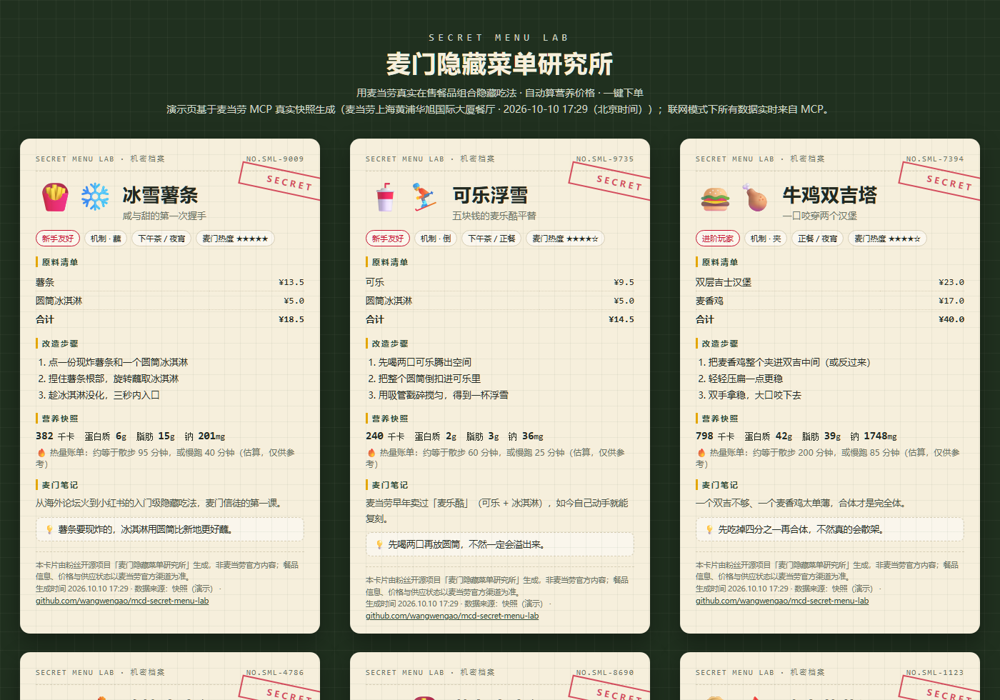
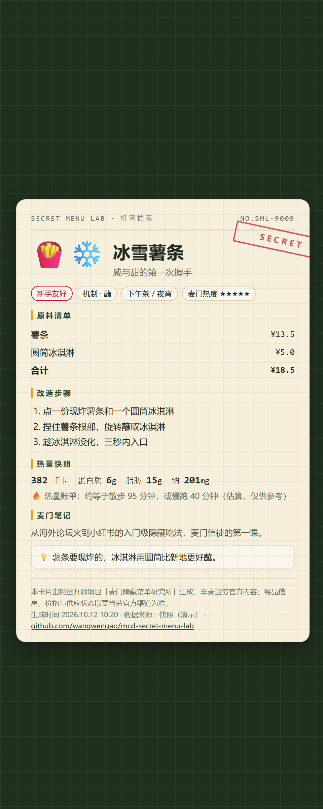
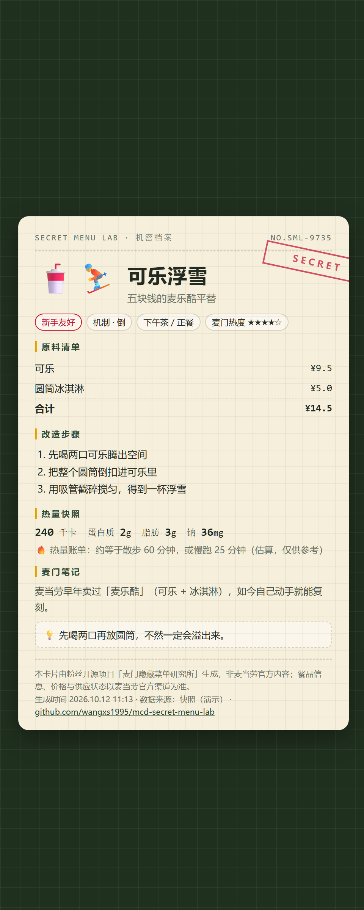
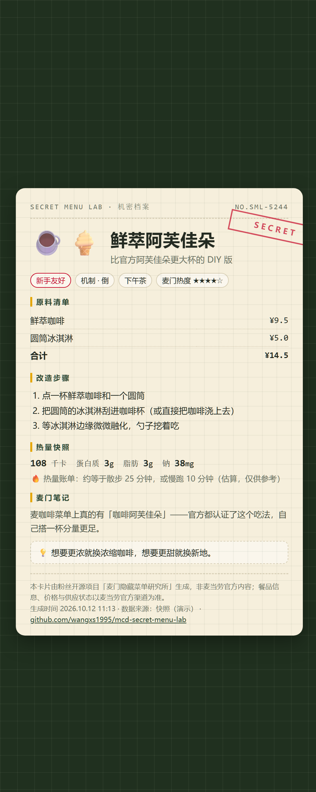
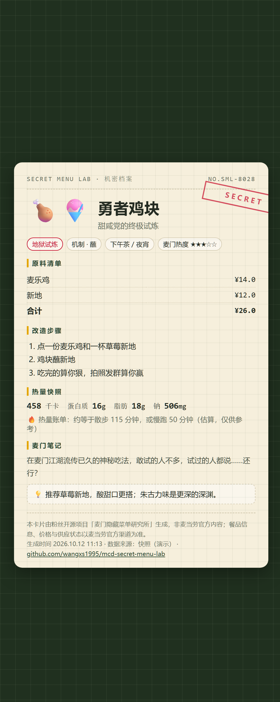
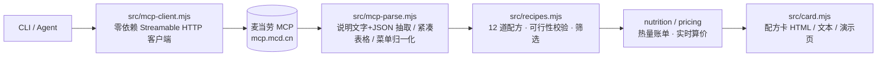

<p align="center">  
    
</p>

<h1 align="center">🍟 麦门隐藏菜单研究所</h1>  
<p align="center"><b>MCD Secret Menu Lab</b> · 用麦当劳真实在售餐品，发明、验证、下单「隐藏吃法」</p>

<p align="center">  
  <a href="https://github.com/wangwengao/mcd-secret-menu-lab/stargazers"></a>  
    
    
    
    
    
</p>

> 薯条蘸圆筒、可乐扣冰淇淋、鸡块夹进双吉……这些在小红书上流传的「麦门隐藏吃法」，终于有了一个能**校验门店真能做、算清价格和热量、生成可晒的配方卡、一键下单**的工具。基于麦当劳官方 MCP，零依赖，没有 Token 也能完整体验。

<p align="center">  
  <a href="./README.en.md">English</a> · <a href="https://wangwengao.github.io/mcd-secret-menu-lab/demo.html">在线演示</a> · <a href="#快速开始">快速开始</a> · <a href="./MCP_INTEGRATION.md">MCP 集成说明</a> · <a href="./docs/share/README.md">分享素材</a>  
</p>

## 这是什么？

把麦当劳菜单玩成一个实验室：

- **图鉴**：12 道隐藏吃法，每一道的原料都是门店真实在售餐品（不是脑补的）
- **校验**：实时拉取门店菜单，告诉你今天哪些吃法能做、缺什么
- **实验室**：按预算 / 热量 / 时段筛方案，自动联动当前时段与麦当劳活动日历
- **配方卡**：生成「机密档案」风格的卡片，截图就能发小红书 / 朋友圈
- **下单**：MCP 实时算价（含优惠），确认后一键创建订单

**和常见做法的区别**

|      | 常见做法        | 本项目                            |
| ---- | ----------- | ------------------------------ |
| 隐藏吃法 | 社交平台截图，真假难辨 | 原料全部来自实时菜单，这家店今天能不能做一查便知       |
| 价格   | 语言模型「估一下」   | `calculate-price` 实时算，含优惠与取餐方式 |
| 时段   | 不区分         | 按服务器时间推断场景；早餐吃法只在早餐时段出现        |
| 活动   | 不联动         | 读活动日历，推荐时带上当前活动                |
| 离线体验 | 手写假数据       | 真实快照（183 个餐品 + 158 项营养），一条命令刷新 |
| 产出物  | 一段文字        | 配方卡 PNG + 可筛选 / 随机抽取的在线页       |

## 30 秒看效果

**在线演示页**（零安装，纯静态）：[wangwengao.github.io/mcd-secret-menu-lab/demo.html](https://wangwengao.github.io/mcd-secret-menu-lab/demo.html) · 或直接打开仓库里的 [`docs/demo.html`](./docs/demo.html)  
按场景 / 难度筛选、搜原料、🎲「今天吃什么？随机来一道」、一键复制文字版配方——12 张配方卡全部基于真实快照。

<table>  
  <tr>  
    <td align="center">  
🍟❄️ 冰雪薯条</td>  
    <td align="center">  
🥤⛷️ 可乐浮雪</td>  
    <td align="center">  
☕🍦 鲜萃阿芙佳朵</td>  
    <td align="center">  
🍗🍧 勇者鸡块</td>  
  </tr>  
</table>

**真实运行记录**（联网模式，上海某门店，2026-10-10 17:12）：

```text
$ node src/lab.mjs lab --store 1450713

🧪 实验室报告（实时菜单 · 自动场景：正餐（按 17:12，可用 --vibe 覆盖））
🎪 活动联动：韩式风味蘸酱上新❤️就「酱」心有所「薯」；麦当劳 X PEACEMINUSONE；麦当劳联动G-DRAGON

  方案 1：🍔🍟 薯条夹击堡 —— 把快乐夹进面包里
     原料：巨无霸 + 薯条
     估算：¥39.0 · 802 千卡 · 新手友好
     步骤：打开巨无霸的顶层 → 塞入一把薯条（蘸不蘸酱随你） → 盖上盖子，趁薯条还脆咬下去
     下单：node src/lab.mjs order --recipe fries-burger --store 1450713

  方案 2：🥤⛷️ 可乐浮雪 —— 五块钱的麦乐酷平替
     原料：可乐 + 圆筒冰淇淋
     估算：¥14.5 · 240 千卡 · 新手友好
     ...

$ node src/lab.mjs price --recipe fries-float --store 1450713

💰 冰雪薯条 · MCP 实时算价（门店 1450713）

  · 中薯条　¥13.5
  · 圆筒冰淇淋　¥5.0
  合计 ¥18.5
  取餐方式：堂食(eat-in) / 外带(locker-out)
```

## 12 道隐藏吃法

|      | 吃法       | 一句话               | 原料               | 难度 | 场景       |
| ---- | -------- | ----------------- | ---------------- | -- | -------- |
| 🍟❄️ | 冰雪薯条     | 咸与甜的第一次握手         | 薯条 + 圆筒冰淇淋       | 新手 | 下午茶 / 夜宵 |
| 🥤⛷️ | 可乐浮雪     | 五块钱的麦乐酷平替         | 可乐 + 圆筒冰淇淋       | 新手 | 下午茶 / 正餐 |
| 🍔🍗 | 牛鸡双吉塔    | 一口咬穿两个汉堡          | 双层吉士汉堡 + 麦香鸡     | 进阶 | 正餐 / 夜宵  |
| 🍔🧨 | 鸡块夹击堡    | 给汉堡加装弹药           | 双层吉士汉堡 + 麦乐鸡     | 进阶 | 正餐       |
| 🍔🍟 | 薯条夹击堡    | 把快乐夹进面包里          | 巨无霸 + 薯条         | 新手 | 正餐 / 夜宵  |
| 🥧🔥 | 冰火菠萝派    | 三分钟搭一个甜品台         | 派（菠萝）+ 圆筒冰淇淋     | 新手 | 下午茶      |
| ☕🍦  | 鲜萃阿芙佳朵   | 比官方阿芙佳朵更大杯的 DIY 版 | 鲜萃咖啡 + 圆筒冰淇淋     | 新手 | 下午茶      |
| 🍟🎵 | 酸甜摇摇薯    | 不用摇摇粉也能摇          | 薯条 + 麦乐鸡（的酱）     | 新手 | 下午茶 / 夜宵 |
| 🌅🍳 | 薯饼夹击堡    | 早八人的加装包           | 猪柳蛋麦满分 + 脆薯饼     | 新手 | 早餐       |
| 🌅🥖 | 豆浆泡油条    | 中式早点的麦记解法         | 脆香油条 + 优品豆浆 + 美式 | 新手 | 早餐       |
| 🍗🍧 | 勇者鸡块     | 甜咸党的终极试炼          | 麦乐鸡 + 新地（草莓）     | 地狱 | 下午茶 / 夜宵 |
| 💰✨  | 1+1 魔法组合 | 两套随心配拼出一个四件套      | 随心配 1+1 ×2       | 新手 | 正餐 / 夜宵  |

所有改造动作（拆 / 夹 / 蘸 / 摇）都是你拿到餐之后自己完成，不需要门店做任何特殊处理。完整图鉴见 [`references/recipes.md`](./references/recipes.md)。

## 快速开始

```bash
git clone https://github.com/wangwengao/mcd-secret-menu-lab.git
cd mcd-secret-menu-lab

# 1) 不需要 Token，先玩起来（内置真实快照：183 个餐品 + 158 项营养数据）
node src/lab.mjs recipes
node src/lab.mjs lab --budget 30 --vibe 夜宵
node src/lab.mjs card --recipe fries-float        # 生成 output/card-fries-float.html

# 2) 接上麦当劳 MCP（Token 申请：https://open.mcd.cn/mcp）
cp .env.example .env                              # 填入 MCD_MCP_TOKEN
node src/lab.mjs doctor                           # 自检：连通性 / 工具列表 / 服务器时间
node src/lab.mjs stores --city 上海市 --keyword 人民广场
node src/lab.mjs menu  --store 1450713            # 实时菜单 + 今日可做的吃法
node src/lab.mjs lab   --store 1450713            # 自动时段 + 活动联动
node src/lab.mjs price --recipe cola-float --store 1450713
node src/lab.mjs order --recipe cola-float --store 1450713        # 预演（dry-run）
node src/lab.mjs order --recipe cola-float --store 1450713 --yes  # 真实下单
```

要求：Node.js ≥ 18，零第三方依赖。`npm test` 运行 12 个自测。

## 在 Agent 里使用（WorkBuddy / Claude / Cherry Studio / Cursor）

1. 按 [`mcp-config.example.json`](./mcp-config.example.json) 配置麦当劳 MCP 连接器，把 `${MCD_MCP_TOKEN}` 换成你的 Token
2. 安装 Skill：`.\install.ps1`（Windows）或 `bash install.sh`（macOS / Linux）会把它装进 WorkBuddy 与 Claude Code 的技能目录；其他客户端直接加载 [`SKILL.md`](./SKILL.md)。各客户端的 MCP 配置模板见 [`mcp-config/`](./mcp-config/README.md)，也可下载 [`dist/mcd-secret-menu-lab-skill.zip`](./dist/mcd-secret-menu-lab-skill.zip) 在 GUI 里导入
3. 对话：

> **你**：晚上加班想吃点不一样的，30 块以内。  
> **Agent**：（运行 `lab --budget 30 --vibe 夜宵`）给你 3 个方案 —— 可乐浮雪 ¥14.5 / 冰雪薯条 ¥18.5 / 勇者鸡块 ¥26……要生成配方卡还是直接下单？  
> **你**：第一个，下单。  
> **Agent**：（`order` 预演 → 你确认 → `--yes`）订单已创建，支付链接在这里；记得先喝两口可乐再放圆筒 😉

Skill 支持两种模式：**模式 A** 调用本仓库 CLI（推荐，价格与营养由确定性代码计算）；**模式 B** 直接编排 MCP 工具（`query-nearby-stores → query-meals → query-meal-detail → list-nutrition-foods → calculate-price → create-order`），详见 `SKILL.md`。

## 命令总览

| 命令        | 作用                                                     | 需要 Token    |
| --------- | ------------------------------------------------------ | ----------- |
| `recipes` | 隐藏吃法图鉴（`--vibe` / `--tag` / `--difficulty` / `--json`） | 否           |
| `menu`    | 门店菜单 + 今日可做的吃法（`--store`）                              | 联网时需要，否则用快照 |
| `lab`     | 按预算 / 热量 / 场景筛方案；联网时自动按服务器时间推断时段并联动活动日历                | 同上          |
| `card`    | 生成配方卡 HTML（`--png` 自动截图成图片；`--spec '{...}'` 为自创吃法出卡；`--format text` 只输出文本） | 同上          |
| `price`   | 实时算价（含优惠、取餐方式）                                         | 是           |
| `order`   | 下单（默认预演，`--yes` 真实下单，`--takeway eat-in/locker-out`）    | 是           |
| `stores`  | 查询门店（`--city` + `--keyword`）                           | 是           |
| `demo`    | 重新生成 `docs/demo.html`                                  | 否           |
| `doctor`  | 环境自检                                                   | 是           |
| `lint`    | 文案合规自检：歧视 / 贬低、品牌对比、功效宣称、迷信、绝对化用语（`--text` / `--file`，缺省扫描仓库文档与全部配方） | 否 |

所有命令支持 `--json`（便于 Agent 解析）与 `--offline`（强制用快照）。

## 它是怎么工作的



用到的 MCP 工具：`query-nearby-stores` · `query-meals`（含 `reservationDate` 拉早餐菜单）· `list-nutrition-foods` · `now-time-info` · `campaign-calendar` · `calculate-price` · `create-order`，以及联调验证过的 `query-meal-detail` · `query-store-coupons`。调用流程、真实返回形态与联调证据见 [`MCP_INTEGRATION.md`](./MCP_INTEGRATION.md)。

一个原则：**数据与计算交给确定性代码，表达交给 Agent。** 餐品来自 `query-meals`、价格来自 `calculate-price`、营养来自 `list-nutrition-foods`，语言模型不做心算、不臆造餐品。

## 目标用户

| 用户             | 场景                           |
| -------------- | ---------------------------- |
| 麦门信徒 / 爱尝鲜的年轻人 | 想试新吃法，但想先知道这家店今天能不能做、要多少钱    |
| 内容创作者          | 一键出配方卡，直接当小红书 / 朋友圈素材        |
| 学生党 / 打工人      | 预算 30 以内吃得有意思（1+1 魔法组合、可乐浮雪） |
| 用 Agent 点餐的人   | 把「来个隐藏吃法」变成一句话的事             |

## 数据与诚实说明

- **离线快照是真的**：`src/sample-data/` 由 [`scripts/refresh-sample-data.mjs`](./scripts/refresh-sample-data.mjs) 从麦当劳 MCP 拉取（2026-10-10，上海某门店到店菜单 + 次日早餐菜单 + 全量营养表），不是手写的。你可以用自己的 Token 一条命令刷新。
- **价格以 MCP 实时算价为准**：离线显示的是快照价格；联网时 `price` / `order` 调用 `calculate-price`，含优惠与取餐方式。
- **营养是估算**：按营养表累加，部分组合类餐品（如随心配）无营养数据会标注「待补全」；不构成营养或医疗建议。
- **时段决定菜单**：下午拉不到早餐单品，早餐吃法会提示「缺」——这是真实情况，不是 bug。
- **v1 聚焦到店自取**：外送（麦乐送）需要配送地址与 `beCode`，在路线图中。
- 本项目为粉丝开源作品，**非麦当劳官方产品**；餐品信息、价格及供应状态以麦当劳官方渠道的实时结果为准。

## 项目结构

```
mcd-secret-menu-lab/
├── README.md                    # 本文
├── SKILL.md                     # Agent Skill 入口（WorkBuddy / Claude / Cherry Studio）
├── MCP_INTEGRATION.md           # MCP Server / Tool / 调用流程 / 联调证据 / 业务价值
├── CONTEST_DECLARATION.md       # 参赛声明（官方原文）
├── mcp-config.example.json      # MCP 配置模板（仅环境变量占位符）
├── .env.example                 # Token 配置模板
├── src/
│   ├── lab.mjs                  # CLI 入口（recipes / menu / lab / card / price / order / stores / demo / doctor / lint）
│   ├── mcp-client.mjs           # 零依赖 MCP Streamable HTTP 客户端
│   ├── compliance.mjs           # 文案合规自检（lint 命令与测试共用）
│   ├── mcp-parse.mjs            # 真实返回解析（说明文字 + JSON / 紧凑表格 / 菜单 / 活动日历）
│   ├── recipes.mjs              # 12 道隐藏吃法知识库 + 匹配 / 校验 / 筛选
│   ├── nutrition.mjs            # 营养累加 + 热量账单
│   ├── pricing.mjs              # 本地小计 + MCP 实时算价
│   ├── card.mjs                 # 配方卡 HTML / 文本 / 演示页渲染
│   ├── sample.mjs               # 快照加载
│   └── sample-data/             # 真实快照：menu.json（183 项）、nutrition.json（158 项）
├── scripts/
│   ├── refresh-sample-data.mjs  # 用你的 Token 刷新快照
│   └── build-dist.ps1           # 打包 Skill ZIP
├── mcp-config/                  # 各客户端 MCP 配置模板（WorkBuddy / Cursor / Claude Code / VS Code）
├── install.ps1 · install.sh     # 一键安装 Skill 到 WorkBuddy / Claude Code
├── references/recipes.md        # 图鉴（Agent 模式 B 参考）
├── assets/cards/*.png           # 12 张配方卡
├── docs/demo.html               # 交互演示页（GitHub Pages）
├── docs/share/                  # 分享素材（小红书 / 知乎 / 朋友圈）
├── docs/DESIGN.md               # 设计文档
├── .github/ISSUE_TEMPLATE/      # 隐藏吃法投稿模板
├── CONTRIBUTING.md · CHANGELOG.md · README.en.md
└── test/selftest.mjs            # 自测（node --test）
```

## 路线图

- [ ] 外送场景（`delivery-query-addresses` → `delivery-query-stores` → 麦乐送下单）
- [ ] 自动套券：`query-store-coupons` / `auto-bind-coupons` 与 `calculate-price` 联动
- [ ] 随心配 / 套餐的 `query-meal-detail` 子项选择

**投稿你的隐藏吃法**：不用写代码，到 [Issues → 🍟 投稿一个隐藏吃法](../../issues/new?template=recipe.yml) 填表即可；通过的吃法会加入图鉴并署名。详见 [CONTRIBUTING.md](./CONTRIBUTING.md)。

## 🧑‍🍳 社区投稿墙

虚位以待——第一个被收录的投稿吃法会出现在这里，并署名投稿人。投稿入口：[Issues → 🍟 投稿一个隐藏吃法](../../issues/new?template=recipe.yml)。

## 分享素材

想把它介绍给朋友？[`docs/share/`](./docs/share/README.md) 里有现成的小红书 / 知乎 / 朋友圈文案与配图直链，全部原创、随意改写。

## FAQ

- **没有 Token 能用吗？** 能。所有命令自动降级为真实快照；只有 `price` / `order` / `stores` / `doctor` 需要联网。
- **为什么早餐吃法显示「缺」？** 早餐单品只在早餐时段上架。联网时按服务器时间判断；离线快照已合并次日早餐菜单。
- **价格为什么和我看到的不一样？** 离线显示快照价；联网时以 `calculate-price` 实时结果为准，门店、时段、优惠都会影响。


- **会不会替我付款？** 不会。`create-order` 只创建订单并返回支付入口，支付在麦当劳官方渠道完成；而且必须显式加 `--yes`。
- **能加我自己的吃法吗？** 能，用 Issue 模板投稿，或按 [CONTRIBUTING.md](./CONTRIBUTING.md) 提 PR。
- **在 WorkBuddy / Claude 里对话，回复里怎么没有卡片？** 卡片是 CLI 生成的 HTML / PNG 文件，聊天窗口只显示文字。Skill 已要求 Agent 在回复里按「文字版配方卡」格式输出，并对图鉴 12 道附上在线卡片链接；想要图片版，让它运行 `node src/lab.mjs card --recipe <id> --png`，自创吃法用 `card --spec '{...}' --png`，生成的文件路径会出现在回复里。

## 参赛信息

本项目参加 [麦当劳程序员创意开发大赛](https://github.com/M-China/mcd-developer-innovation-challenge)。仓库包含赛事要求的 `README.md`、`CONTEST_DECLARATION.md`（官方原文）、`MCP_INTEGRATION.md`、`mcp-config.example.json` 与完整源代码。

如果这个项目让你想立刻去买一份薯条和圆筒，欢迎点个 ⭐。

<details>
<summary>搜索关键词</summary>

麦当劳隐藏菜单 · 麦当劳隐藏吃法 · 麦门 · 麦当劳 MCP · McDonald's MCP · MCP Skill · 麦当劳点餐助手 · 薯条蘸冰淇淋 · 可乐浮雪 · 麦当劳 Agent · WorkBuddy 技能 · Claude Code Skill · 程序员节 · 麦当劳程序员创意开发大赛

</details>

## License

[MIT](./LICENSE) © 2026 wangwengao
